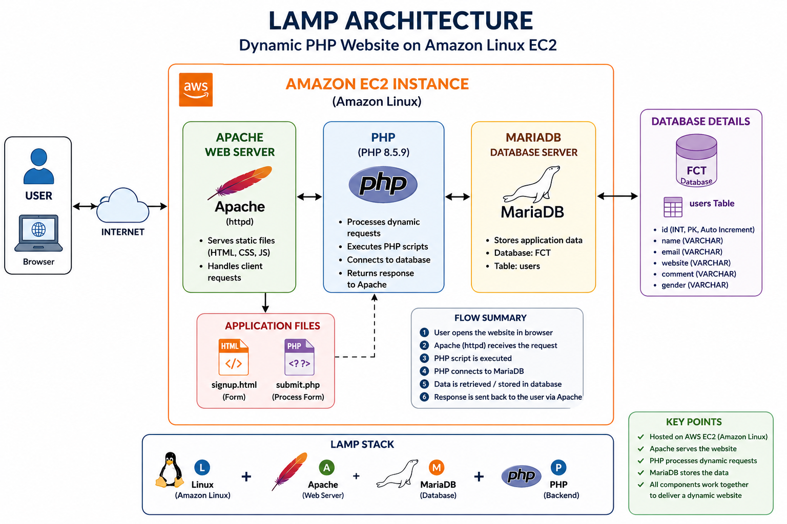

# 🚀 Dynamic PHP Website Hosting on Amazon Linux using LAMP

> **End-to-end deployment of a dynamic PHP signup application on Amazon EC2 with Apache, MariaDB and PHP.**

## 📌 Project Overview

This project demonstrates how to host a **dynamic PHP website** on an **Amazon Linux EC2 server** using the **LAMP stack**.

The application contains a signup form where a user enters details such as name, email, website, comment and gender. The submitted information is processed by PHP and stored in a MariaDB database.

### 🧱 Technology Stack

| Layer | Technology |
|---|---|
| Cloud | Amazon EC2 |
| Operating System | Amazon Linux |
| Web Server | Apache HTTP Server (`httpd`) |
| Database | MariaDB 11.8 |
| Backend | PHP 8.5.9 |
| Database Connector | `php8.5-mysqlnd` |
| Frontend | HTML |
| Automation | EC2 User Data / Bash |
| Database | `FCT` |
| Table | `users` |

> **Stack used in this implementation: LAMP — Linux + Apache + MariaDB + PHP.**

## 🏗️ Architecture Diagram



## 🎯 Project Objective

The objective was to deploy a working PHP application on AWS and connect it with a MariaDB database.

- Launch and configure an Amazon EC2 server.
- Automate initial setup using EC2 User Data.
- Install and verify Apache, MariaDB and PHP.
- Deploy the signup application.
- Create the MariaDB database and table.
- Connect PHP with MariaDB.
- Troubleshoot the missing `mysqli` connector.
- Submit form data and verify the stored record.

## 🔄 Complete Project Flow

```text
EC2 Launch
   ↓
Amazon Linux
   ↓
EC2 User Data
   ↓
Apache + MariaDB + PHP
   ↓
Initial HTTP Test
   ↓
Deploy signup.html + submit.php
   ↓
Create FCT Database + users Table
   ↓
PHP ↔ MariaDB Connection
   ↓
Fix missing mysqli connector
   ↓
Signup Form Input
   ↓
submit.php
   ↓
INSERT into users
   ↓
Database Record Verification
   ↓
Successful Dynamic Website
```

# 1. ☁️ Amazon EC2 Setup

An Amazon EC2 instance was launched to host the PHP application.

| Configuration | Value |
|---|---|
| Instance Name | PHP Website |
| AMI / OS | Amazon Linux |
| Instance Type | `t3.micro` |
| Key Pair | New key pair created during launch |
| Network | Existing security group selected |
| Application | Dynamic PHP Website |


# 2. ⚙️ Automated Server Setup using EC2 User Data

EC2 User Data was used to automate the initial server setup.

The script:

- Updated the system.
- Installed Apache (`httpd`), MariaDB, PHP and `tree`.
- Started and enabled the required services.
- Created the initial website files.
- Created a temporary Apache test page.


# 3. 🌐 Initial Apache Verification

The EC2 Public IPv4 address was opened in a browser to verify the web server.


**Result:** `httpd test ok`

This confirmed that Apache was serving web content successfully.

# 4. 🔍 Service Verification

The main services were checked using `systemctl`.

- `httpd` — Web server
- `mariadb` — Database server
- `php-fpm` — PHP FastCGI Process Manager


All three services were verified as **active (running)**.

# 5. 📁 Web Application Files

The application files were placed inside the Apache web root:

```text
/var/www/html/
├── signup.html
└── submit.php
```


# 6. 🗄️ MariaDB Database Configuration

MariaDB was configured for the application. The root user's authentication was configured, then the `FCT` database was created and selected.

```sql
CREATE DATABASE FCT;
USE FCT;
```

A `users` table was created with an automatically generated ID:

```sql
CREATE TABLE users (
    id INT PRIMARY KEY AUTO_INCREMENT,
    name VARCHAR(100),
    email VARCHAR(100),
    website VARCHAR(100),
    comment VARCHAR(100),
    gender VARCHAR(20)
);
```


# 7. 📝 PHP Signup Application

The `signup.html` file contains:

- Name
- Email
- Website
- Comment
- Gender
- Submit button

The form sends the data to `submit.php` using the POST method.


# 8. 🐘 PHP Backend Processing

The `submit.php` file receives the form values using `$_POST`, connects to MariaDB using `mysqli_connect()`, and inserts the submitted values into the `users` table.

```text
signup.html
     ↓
POST request
     ↓
submit.php
     ↓
Read form values
     ↓
Connect to MariaDB
     ↓
INSERT query
     ↓
Return result
```

# 9. ❌ Problem Faced: MySQL Connector Missing

During the first form submission, the application returned:

```text
Fatal error: Call to undefined function mysqli_connect()
```


### Problem

PHP could not use `mysqli_connect()` because the required PHP MySQL connector was missing.

# 10. 🔧 Solution: Install PHP MySQL Connector

The installed PHP version was checked:

```bash
php -v
```

The server was running PHP **8.5.9**.

The compatible connector was installed:

```bash
sudo yum install php8.5-mysqlnd.x86_64 -y
```


The required services were then reloaded/restarted and the application was tested again.

### Result

The `mysqli_connect()` error was resolved and PHP could communicate with MariaDB.

# 11. 📥 Application Input

The signup form was filled with user information.


# 12. 📤 Application Output

After clicking **Submit**, the PHP backend processed the form and inserted the record into the database.


**Result:** `New record created successfully!`

# 13. 🗃️ Database Record Verification

The database was checked directly from MariaDB:

```sql
USE FCT;
SELECT * FROM users;
```

The submitted record was successfully displayed in the `users` table.


### Final Data Flow

```text
Browser
   ↓
signup.html
   ↓
submit.php
   ↓
PHP
   ↓
mysqli
   ↓
MariaDB
   ↓
FCT
   ↓
users
   ↓
Record stored successfully ✅
```

# 14. 🧪 Testing & Verification

| Test | Result |
|---|---|
| EC2 instance | ✅ Running |
| Apache/httpd | ✅ Active |
| MariaDB | ✅ Active |
| PHP-FPM | ✅ Active |
| Website files | ✅ Present |
| Apache test page | ✅ Working |
| Signup form | ✅ Loaded |
| PHP form processing | ✅ Working |
| Database connection | ✅ Working after connector installation |
| Record insertion | ✅ Successful |
| Database verification | ✅ Record found |

# 15. 🧩 Problems Faced & Solutions

### Problem 1 — PHP could not connect to the database

**Error:** `Call to undefined function mysqli_connect()`

**Reason:** The PHP MySQL connector was missing.

**Solution:** Checked the PHP version and installed the matching `php8.5-mysqlnd` package.

**Result:** The PHP application successfully connected to MariaDB.

### Problem 2 — Initial server setup required multiple packages and services

**Solution:** Used EC2 User Data to install, start and enable the required services automatically.

**Result:** The basic server environment was ready after instance setup.

# 16. 📚 What I Learned

Through this project, I learned:

- How to launch and configure an EC2 instance.
- How EC2 User Data can automate server setup.
- How Apache works as a web server.
- How to verify Linux services using `systemctl`.
- How to deploy files inside `/var/www/html/`.
- How to install and verify PHP.
- How PHP communicates with MariaDB.
- How to create databases and tables in MariaDB.
- How `PRIMARY KEY` and `AUTO_INCREMENT` work.
- How HTML forms send data using POST.
- How PHP receives form data using `$_POST`.
- How to troubleshoot a PHP database connection error.
- How to install a compatible PHP MySQL connector.
- How to verify that application data is actually stored in the database.

# 17. 🚀 Future Improvements

For a production-ready version, I would improve the project by:

- Using environment variables or AWS Secrets Manager instead of hard-coded database credentials.
- Using PHP prepared statements for database queries.
- Enabling HTTPS with SSL/TLS.
- Using a dedicated database user instead of the MariaDB `root` account.
- Adding stronger input validation and security controls.

# 18. 🏁 Conclusion

This project helped me understand how a **real PHP application can be hosted on AWS from start to finish**.

I learned how to launch an EC2 server, automate the setup using User Data, configure Apache, PHP and MariaDB, create a database, connect PHP with the database, troubleshoot an error and finally store form data successfully.

The most useful part was troubleshooting the `mysqli_connect()` error because it helped me understand that PHP also needs the correct database connector to communicate with MariaDB.

Overall, this project gave me practical experience with **AWS EC2, Linux, Apache, PHP, MariaDB and basic application troubleshooting**.

## ⭐ Final Result

**Dynamic PHP Signup Website Successfully Hosted on Amazon EC2**

```text
AWS EC2
   ↓
Amazon Linux
   ↓
Apache
   ↓
PHP
   ↓
MariaDB
   ↓
Dynamic Signup Application
   ↓
Database Record Stored Successfully ✅
```
